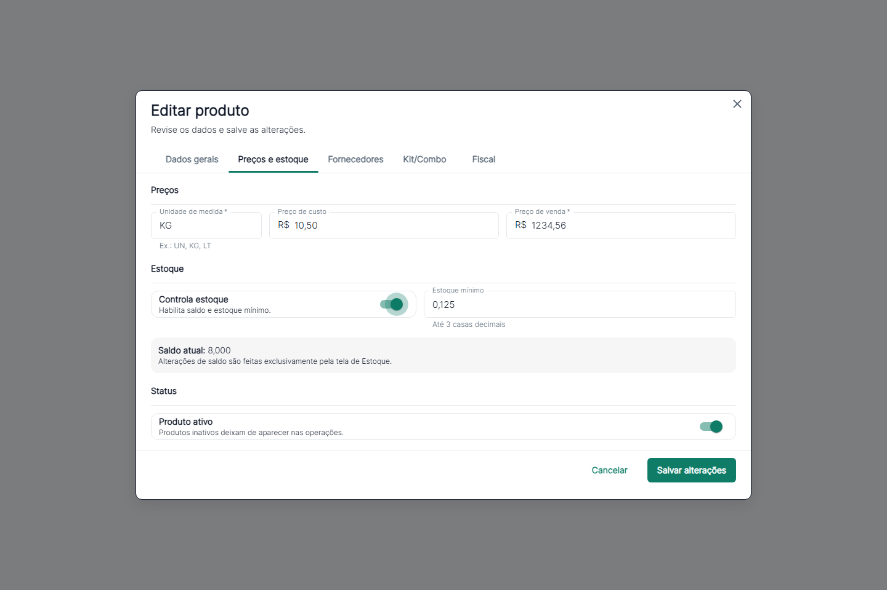
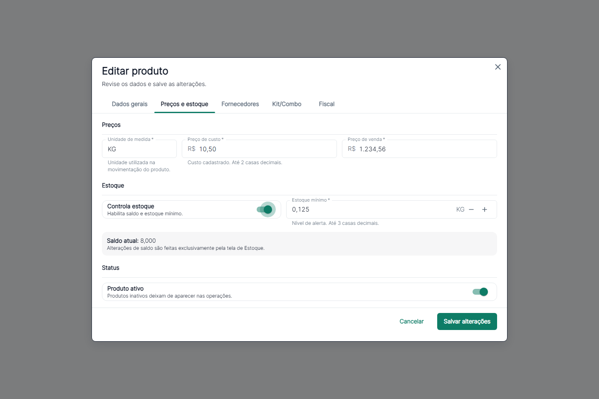
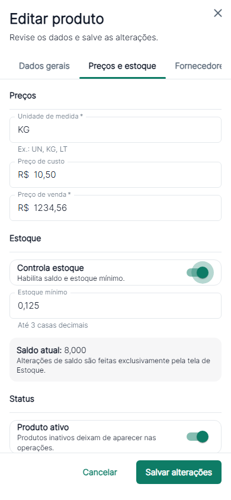
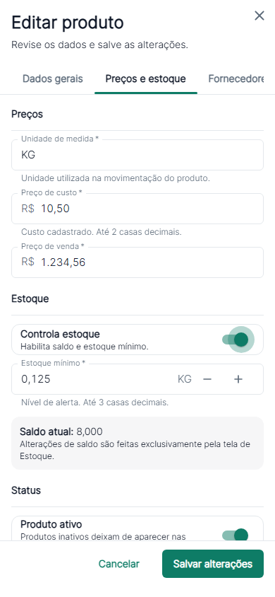

# Padronização dos campos de formulário — piloto Produtos — 2026-10-24

**FORM UX STANDARD READY**, restrito aos componentes e ao piloto local. São 116 testes dirigidos aprovados, incluindo integração real em PostgreSQL, sem regressões funcionais identificadas no escopo. A suíte global mantém 18 falhas preexistentes comprovadas; não está integralmente verde e este parecer não libera publicação do ERP.

## Escopo e estado inicial

`main`, HEAD `71f2ea0224359ad0e886fdc45ab79941f0ce9d17`. Mantidas as alterações anteriores de README, CURRENT_STATE, documentação de deploy, relatório 14D já staged, auditorias paralelas, script/cache de backup, imagens e vídeos. Sem commit, push, deploy, mudança de backend, migration ou acesso à produção.

Piloto limitado ao `ProdutoForm`: cadastro completo, edição, duplicação e cadastro rápido reutilizado por Entradas. Não houve padronização em massa. O tema MUI, `CadastroDialog`, abas, disposição dos campos e regras de Produto foram reaproveitados. Não foi encontrada uma tela específica de Ajuste de Custo ou um campo editável de custo médio nesse cadastro; não foram criados.

## Auditoria e decisões

- Texto: `TextField` já fornece label, ajuda, erro associado e integração ao tema; não foi criado um wrapper redundante. SKU/código interno, GTIN/EAN, nome, descrição, unidade, NCM e CEST receberam exemplos pertinentes.
- NCM e CEST continuam opcionais e sem máscara nova: exemplos com oito/sete dígitos respeitam as validações atuais. Não foi afirmada obrigatoriedade fiscal nem implementada emissão fiscal.
- Valores eram strings durante a edição, convertidas na validação de envio. O formulário aceitava vírgula/ponto decimal, mas não valores agrupados como `1.234,56`.
- O `ValorMonetarioPDV` existente é específico do PDV, limitado a duas casas/nove dígitos inteiros. Seu padrão de texto durante foco e formatação ao sair foi reaproveitado conceitualmente; o PDV e seus cálculos permaneceram intactos.
- Backend confirmado em `ProdutoRequestDTO` e `ProdutoEntity`: preço de custo/venda com duas casas, estoque mínimo com três. A unidade não impõe granularidade inteira nesse contrato; não foi inventada conversão/restrição por unidade.
- Custo com quatro casas é suportado pelo componente genérico para consumidores cujo domínio permita, não pelo custo de Produto. A entrada XML com custo além da precisão continua exigindo revisão, sem arredondamento.
- Percentual tem apresentação com `%` e precisão configurável. Não existe percentual editável no piloto de Produto; seu adaptador foi testado isoladamente, sem alterar taxas financeiras. O teto é explícito por consumidor, não uma regra global nova.

O piloto cobre os campos básicos de identificação, fiscal, preço e estoque mínimo. Quantidade por embalagem dos vínculos de fornecedores (até três casas), quantidade de composição (três) e fator do Kit/Combo (seis) foram mapeados, mas mantêm seus editores/conversões atuais. Esses fluxos avançados não recebem spinbox: uma alteração unitária não tem significado universal para fator de conversão/consumo. Sua apresentação deve ser revisada em etapa própria, com regressões da composição e dos vínculos, antes de migrá-los para os adaptadores novos.

## Componentes e comportamento

`CampoDecimal.tsx` contém a base e os adaptadores `CampoMonetario`, `CampoQuantidade` e `CampoPercentual`. `numeroFormulario.ts` centraliza normalização, formatação e incremento exato por inteiros escalados (`BigInt`), sem nova dependência.

- `type="text"` e `inputMode="decimal"`: digitação manual, teclado móvel e colagem preservados. Não há alteração de valor por roda do mouse.
- Durante foco, o texto não é reescrito a cada tecla; ao sair, valores válidos são apresentados por `Intl.NumberFormat("pt-BR")`. Uma edição local evita que a troca entre texto e apresentação sobrescreva uma digitação/colagem ao receber foco.
- Entradas inválidas ficam visíveis e sinalizadas. Não são descartadas, convertidas em zero ou arredondadas para caber na precisão. Vazio permanece vazio; validações obrigatórias existentes continuam impedindo envio.
- Vírgula ou ponto decimal aceitos. Agrupamento brasileiro requer vírgula decimal: `1.234,56`. Um ponto sem vírgula é interpretado como separador decimal, evitando inferir silenciosamente uma escala diferente. `R$` na colagem é aceito somente no campo monetário.
- Erro de validação prevalece sobre a ajuda. Identificação, limites de caracteres, fiscal opcional, estado de carregamento/salvamento, vínculos, avisos de operação e dados após falha de API permanecem existentes.
- Preços não receberam spinbox: não existe passo comercial definido para preço, e a digitação direta evita alterações acidentais. Identificadores e unidade textual também não recebem incremento. Custo calculado de Kit/Combo continua desabilitado.
- Custo e estoque mínimo mostram obrigatoriedade conforme a validação já existente do formulário, exceto custo calculado de composto e estoque sem controle. Nenhuma validação obrigatória foi removida.
- Estoque mínimo recebe botões +/−, passo de uma unidade informada, piso zero e até três casas na digitação manual. Não modifica saldo de estoque. Setas ↑/↓ e Enter nos botões funcionam; ações usam `type="button"`, nomes acessíveis e limites. Botões têm 44 px em mobile e 32 px em desktop.
- O campo de estoque e seus botões ficam desabilitados quando não há controle de estoque. A semântica de envio de estoque mínimo zero nesse caso permanece existente.

### Precisão e contrato

| Entrada | Componente de quatro casas | Preço do Produto, duas casas |
|---|---|---|
| `0,0002` | Apresenta `0,0002`, número `0.0002` | Rejeita; não transforma em `0,00` |
| `1,2500` | Apresenta `1,2500`, número `1.25` | Rejeita a precisão excedente |
| `10,50` | Apresenta `10,5000`, número `10.5` | Apresenta `R$ 10,50`, número `10.5` |
| `1.234,56` | Apresenta `1.234,5600`, número `1234.56` | Apresenta `R$ 1.234,56`, número `1234.56` |

O contrato HTTP continua usando `number`. A conversão verifica limite de inteiro escalado seguro e ida/volta decimal antes do envio; valores que perderiam dígitos são recusados. Não houve alteração da precisão SQL. Representar toda a faixa de `numeric(19,2)`/`numeric(19,3)` em JSON exigiria uma evolução separada do contrato; esta tarefa protege contra perda silenciosa e não a implementa.

## Validação

| Suíte/verificação | Executados | Aprovados | Falhas | Ignorados |
|---|---:|---:|---:|---:|
| Novos testes: normalização/precisão, interação, PostgreSQL real e visual | 40 | 40 | 0 | 0 |
| Regressões finais de Entradas, Fornecedor de Produto, duplicação, Kits e Categorias | 76 | 76 | 0 | 0 |
| Suíte global de diagnóstico, antes da atualização das duas expectativas de Entradas | 631 | 609 | 20 | 2 |
| Prova estática com arquivos do HEAD | 6 | 0 | 6 | 0 |
| Prova de baseline de Listagens/Políticas, teste extraído do HEAD e dependências sem alterações | 32 | 19 | 13 | 0 |

Os 116 testes dirigidos são distintos; não somar novamente suas execuções incluídas no diagnóstico global. Os dois ignorados da suíte global são precisamente os casos opt-in PostgreSQL e visual, posteriormente executados e aprovados na rodada final de 40.

Das 20 falhas globais, duas acompanhavam a apresentação anterior do Produto: custo `3,5` em vez de `3,50` e seletor genérico “Estoque mínimo”, que passou a localizar também os botões acessíveis. Foram ajustadas somente essas duas linhas em `entrada-mercadoria.test.mjs`: valor apresentado com duas casas e seletor pelo papel `spinbutton`. As asserções de payload, API, fluxo e precisão foram mantidas; o arquivo completo passou na regressão final. Não houve mudança de domínio para satisfazer testes.

As outras **18 falhas** foram comprovadas na baseline: seis asserções estáticas antigas, sete casos de Contas financeiras/Listagens e cinco de Agenda de recebimentos. A prova de Listagens inclui novamente uma das seis estáticas; por isso 6 + 13 falhas das duas provas representam 18 casos únicos, não 19. Exemplos: regex de autofocus/Identificação anterior às abas, título literal da Central de Vendas, seletores de tabela ambíguos após painel de Cofre e botão “Confirmar recebimento” ausente na fixture da Agenda. Esses testes, páginas e regras financeiras permaneceram intactos. Não são aprovação da suíte global nem falhas ocultadas.

Primeira chamada pelo script npm produziu também timeouts concorrentes. O diagnóstico foi repetido com `node --test --test-concurrency=1 tests/*.test.mjs`, parâmetro antes dos arquivos, sem alterar scripts/timeouts existentes. Após as atualizações pontuais de apresentação/semântica, foram repetidos somente os testes afetados, culminando nos 116 aprovados; a suíte global custosa não foi repetida integralmente.

Build final `npm run build` e TypeScript aprovados. `npm run lint`: zero erros, dois avisos preexistentes de React Hook Form (`ConfiguracaoFormaPagamentoForm` e `ContaBancariaForm`). Mantidos aviso de bundle acima de 500 kB e aviso npm sobre `min-release-age`, sem atualizar dependências. `git diff --check` aprovado; detector mecânico Impeccable sem achados. Revisão de acessibilidade orientada pelas [Web Interface Guidelines](https://raw.githubusercontent.com/vercel-labs/web-interface-guidelines/main/command.md), sem alteração global do tema.

Integração real adicional com o JAR backend previamente aprovado, SHA-256 `5260d26922aebefc556c8c0a1e106ce479fbc23091b1dba7127babcb51105cab`, API isolada e PostgreSQL **18.6** criado em diretório temporário novo. Profiles/URLs explicitamente locais, sem importar a configuração local original; Supabase configurado para destino dummy loopback inacessível. Somente dois tenants/usuários sintéticos foram semeados.

O navegador salvou por POST e editou por PUT; GET real confirmou os valores. Outro tenant recebeu 404. A integração foi repetida com o diff final, criando um segundo produto sintético e preservando o primeiro. Conferência SQL final de ambos: `preco_custo = 0.00`, `preco_venda = 10.50`, `estoque_minimo = 0.125`, `estoque_atual = 0.000`; zero vendas, pagamentos, movimentos financeiros e movimentos de estoque. Schema V58, 43 tabelas. API e cluster descartáveis encerrados; arquivos do teste preservados. Serviços locais originais nas portas 5432/8080/5173 mantiveram os PIDs anteriores e não foram reiniciados nem usados para gravação.

O caso HTTP real exige opt-in, estado de ambiente identificado como `novexa_forms_test`, diretório temporário exclusivo, loopback e portas diferentes de 5432/8080. Por padrão, os demais testes interceptam HTTP e não alcançam um backend real.

Testes de interface com HTTP simulado verificam também erro 409 sem perda de dados e releitura da fixture após salvar; esses casos não são apresentados como persistência real. A comprovação PostgreSQL é a integração separada acima.

## Evidências visuais

Capturas do mesmo componente e fixture sintética antes/depois, no tema existente, desktop 1440×960 e mobile 390×844, claro/escuro. A versão anterior foi capturada da cópia do arquivo anterior à tarefa, sem restaurar arquivos no worktree. Transições concluídas/desabilitadas apenas na captura; animações da aplicação não foram modificadas. Comparação visual final conferida, sem ampliar o redesenho.

Placeholders: cor secundária do tema, opacidade 1, contraste medido **5,46:1** no claro e **8,82:1** no escuro. Valores e medição de limites estão em [medidas.json](assets/formularios-2026-10-24/medidas.json). Os testes verificaram teclado, botões, limites, erros, colagem, ausência de alteração por wheel, campo dentro do viewport e ausência de erros JavaScript. Viewports de navegador não equivalem a testes em dispositivo físico ou leitor de tela.

| Desktop — antes | Desktop — depois |
|---|---|
|  |  |

| Mobile — antes | Mobile — depois |
|---|---|
|  |  |

Demais comparações: [dados gerais antes](assets/formularios-2026-10-24/antes-desktop-claro-dados.png), [dados gerais depois](assets/formularios-2026-10-24/depois-desktop-claro-dados.png), [escuro antes](assets/formularios-2026-10-24/antes-desktop-escuro-precos.png) e [escuro depois](assets/formularios-2026-10-24/depois-desktop-escuro-precos.png).

## Arquivos da entrega

- `frontend/src/components/ui/CampoDecimal.tsx` — base e três adaptadores numéricos.
- `frontend/src/utils/numeroFormulario.ts` — conversão e passos exatos.
- `frontend/src/pages/Produtos/ProdutoForm.tsx` — aplicação piloto e textos.
- `frontend/tests/campos-formulario.test.mjs` — casos de conversão/precisão/limites.
- `frontend/tests/produto-campos-form.test.mjs` — interação, contratos, responsividade, integração PostgreSQL opt-in e capturas opt-in.
- `frontend/tests/entrada-mercadoria.test.mjs` — duas expectativas de apresentação/seletor atualizadas, mantendo as asserções do payload e fluxo.
- `docs/architecture/frontend.md`, `docs/architecture/CURRENT_STATE.md`, este relatório e oito capturas/arquivo de medidas em `docs/audits/assets/formularios-2026-10-24/`.

## Estado final e limitações

HEAD permanece `71f2ea0` em `main`, sem commit/push/deploy desta tarefa. Staging anterior da 14D preservado, sem adicionar arquivos da 15. Alterações paralelas conferidas por hashes; o conteúdo anterior de CURRENT_STATE foi preservado integralmente, com uma seção nova de estado local.

O piloto está pronto no escopo validado. Permanecem a dívida de testes globais descrita acima, a limitação do contrato numérico para valores extremos, a ausência de teste em dispositivos físicos/leitor de tela e a expansão deliberadamente não iniciada. Não foi criada funcionalidade de Ajuste de Custo nem aumentado o número de casas de um campo persistido.

## Continuidade recomendada

Após aprovação separada: custo unitário e quantidade em Entradas, respeitando a precisão própria; depois Estoque e formulários de Contas a Pagar/Receber. Reavaliar reaproveitamento do PDV somente em tarefa específica, preservando seus cálculos e atalhos já validados. Não foi iniciada expansão para esses módulos.

Antes dessa expansão, pode-se concluir a apresentação dos campos avançados de Fornecedores/Kit dentro do cadastro de Produto. Uma eventual tela de Ajuste de Custo permanece apenas uma oportunidade futura dependente de decisão de produto, fora desta entrega.
